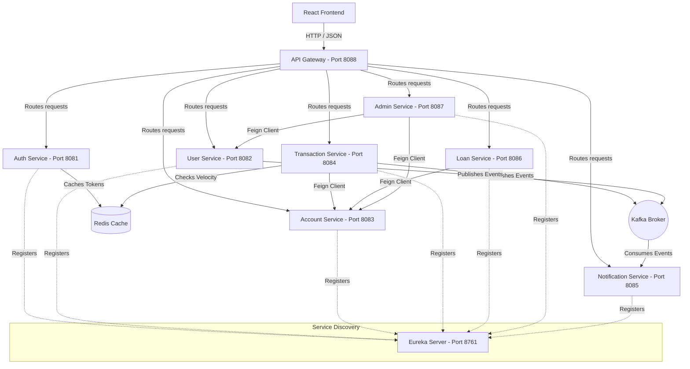
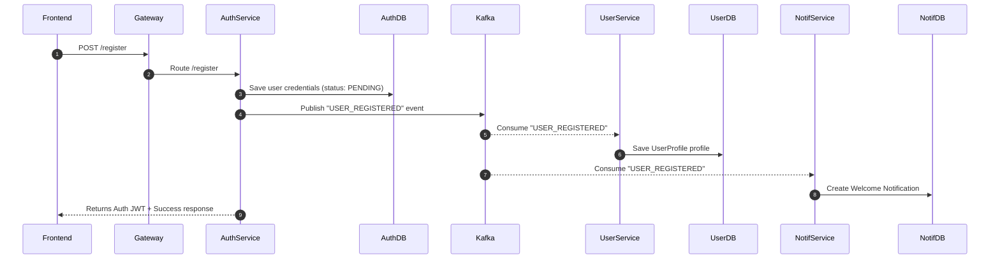
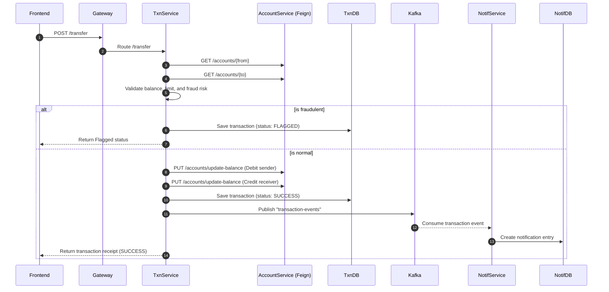

# Banking System Architecture & ER Diagrams

This document outlines the current microservice architecture, database ER models, and transaction/data flows for the Enterprise Banking System to help you recall how the system works.

---

## 1. System Architecture

The application is built as a set of decoupled Spring Boot microservices. They communicate synchronously using Feign Clients and asynchronously using Apache Kafka. Service registration and routing are managed by Spring Cloud Eureka and Spring Cloud Gateway.

---

## 2. Entity-Relationship (ER) Diagram (Databases)

Since this is a microservices system, each service has its own dedicated MySQL database to enforce service boundary isolation. Below is the conceptual ER diagram showing the schemas, tables, and logical linkages (e.g. `userId` or `accountNumber` connections across service boundaries).

```mermaid
erDiagram
    %% Auth Database
    USERS {
        Long id PK
        String fullName
        String email UK
        String password
        String phone
        String role
        Boolean enabled
        Boolean accountNonLocked
        String kycStatus
        LocalDateTime createdAt
        LocalDateTime updatedAt
    }
    
    REFRESH_TOKENS {
        Long id PK
        String token UK
        Long user_id FK
        LocalDateTime expiresAt
        Boolean revoked
        LocalDateTime createdAt
    }
    
    USERS ||--o{ REFRESH_TOKENS : has

    %% User Database
    USER_PROFILES {
        Long id PK
        Long authUserId UK
        String email UK
        String fullName
        String phone
        LocalDate dateOfBirth
        String panNumber UK
        String aadharNumber UK
        String pincode
        String address
        String city
        String state
        String kycStatus
        LocalDateTime kycApprovedAt
        String profilePictureUrl
        Boolean enabled
        Boolean accountNonLocked
        LocalDateTime createdAt
        LocalDateTime updatedAt
    }

    %% Account Database
    ACCOUNTS {
        Long id PK
        String accountNumber UK
        Long userId
        String userEmail
        String accountHolderName
        String accountType
        String status
        BigDecimal balance
        String currency
        String ifscCode
        String branchName
        BigDecimal dailyTransferLimit
        BigDecimal transferredToday
        LocalDateTime dailyLimitResetDate
        Long version "Optimistic Lock"
        LocalDateTime createdAt
        LocalDateTime updatedAt
    }
    
    BENEFICIARIES {
        Long id PK
        Long userId
        String name
        String accountNumber
        String bankName
        String ifscCode
        String nickname
        Boolean active
        LocalDateTime createdAt
    }

    ACCOUNTS ||--o{ BENEFICIARIES : saves

    %% Transaction Database
    TRANSACTIONS {
        Long id PK
        String referenceNumber UK
        Long userId
        String fromAccountNumber
        String toAccountNumber
        BigDecimal amount
        BigDecimal balanceBefore
        BigDecimal balanceAfter
        String transactionType "DEPOSIT, WITHDRAWAL, TRANSFER"
        String status "SUCCESS, FLAGGED, PENDING, FAILED"
        String description
        Boolean fraudFlagged
        String fraudReason
        String ipAddress
        String currency
        String channel
        LocalDateTime createdAt
        LocalDateTime completedAt
    }
    
    AUDIT_LOGS {
        Long id PK
        Long userId
        String action
        String entityType
        Long entityId
        String description
        String ipAddress
        LocalDateTime createdAt
    }

    %% Loan Database
    LOANS {
        Long id PK
        String loanNumber UK
        Long userId
        String accountNumber
        String loanType "HOME, PERSONAL, CAR, EDUCATION"
        String status "PENDING, APPROVED, REJECTED, ACTIVE, CLOSED"
        BigDecimal principalAmount
        BigDecimal interestRate
        Integer tenureMonths
        BigDecimal emiAmount
        BigDecimal totalPayable
        BigDecimal outstandingAmount
        LocalDateTime disbursedAt
        LocalDate nextEmiDate
        LocalDateTime closedAt
        String purpose
        LocalDateTime createdAt
        LocalDateTime updatedAt
    }

    %% Notification Database
    NOTIFICATIONS {
        Long id PK
        Long userId
        String title
        String message
        String type "INFO, TRANSACTION, ACCOUNT, FRAUD_ALERT"
        Boolean isRead
        String referenceId
        LocalDateTime createdAt
    }
```

---

## 3. Core Workflows & How They Operate

### Workflow A: User Signup & KYC Upload
1. The **React Frontend** sends user credentials and profile details to the `/api/v1/auth/register` gateway endpoint, which routes it to the `auth-service`.
2. The `auth-service` saves the user login credentials (password is encrypted with BCrypt) in the `banking_auth` database with `kycStatus = 'PENDING'`.
3. An event is emitted via Kafka to `user-events`.
4. The `user-service` is registered as a consumer. It receives the event and automatically initializes the `UserProfile` record.
5. Concurrently, the `notification-service` listens and registers a "Welcome notification" in the UI database, telling the user to complete their KYC.

---

### Workflow B: Money Transfer (Fund Transfer Flow)
1. The user logs in, goes to "Transfers", selects a saved beneficiary, inputs the amount, and clicks transfer.
2. The request goes to `/api/v1/transactions/transfer` inside the `transaction-service`.
3. The `transaction-service` queries the `account-service` via **Feign Client (REST)** to fetch details of both sender and receiver accounts.
4. **Validation checks** run:
   - Are accounts active?
   - Is sender's balance enough?
   - Will this transfer exceed the daily limit?
5. The **Fraud Detection Service** analyzes velocity and amount parameters. If suspicious, it flags the transaction.
6. If the checks pass:
   - The `transaction-service` calls the `account-service` Feign client to debit the sender and credit the receiver (balance updates).
   - The transaction record is marked as `SUCCESS` and saved.
   - An event is published to `transaction-events` Kafka topic.
7. The `notification-service` consumes this event and generates a push notification/email for the user about the debit/credit.

---

### Workflow C: Loan Application & EMI Calculator
1. The user inputs their desired loan amount, tenure, and loan type.
2. The frontend makes a GET request to `loan-service` `/api/v1/loans/calculate` which calculates the monthly EMI, total interest, and total payable amount.
3. If the user submits, a POST request goes to `/api/v1/loans/apply`.
4. The `loan-service` creates a loan record marked as `PENDING`.
5. The admin (via `admin-service`) reviews the user profile, KYC, and loan information and clicks Approve.
6. Upon approval:
   - `loan-service` status changes to `ACTIVE`.
   - `loan-service` calls `account-service` to credit the loan principal amount directly into the user's primary bank account.
   - A disbursement log is created, and the user receives a notification.
